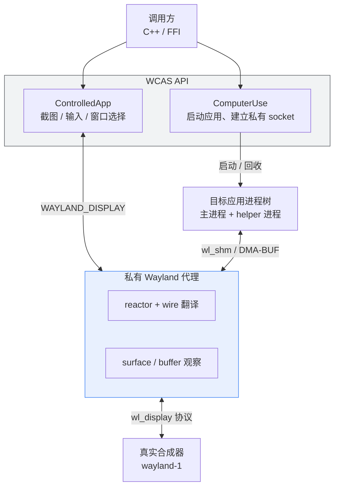

# WCAS

**W**indow **C**ontrol **A**gent **S**ystem · 窗口控制代理系统

跨平台窗口捕获 / 输入注入 / 进程劫持库。当前仅初步实现 **Wayland (Linux)** 路径，
WinAPI 与 Cocoa 后端尚未开始。

> **项目状态：早期实验性（early / experimental）。** API 尚未发布，允许破坏性变更。
> Wayland 代理的核心链路已可用，KMS 抓取、XWayland 完整回退等功能仍在补全。

---

## 这是什么

WCAS 启动一个目标应用，并在它与合成器之间插入一个**私有 Wayland 代理**。
代理按 wire 协议双向转发消息，同时观察并记录该应用的全部窗口状态。
调用方因此可以在不依赖合成器私有协议、不使用 X11 的前提下：

- **捕获窗口画面** —— `wl_shm` 或 DMA-BUF（含 Vulkan 导入）两种路径
- **注入输入** —— 鼠标移动/点击/拖拽/滚轮、按键组合、Unicode 文本
- **枚举与切换窗口** —— 一个应用的多进程、多 surface、多输出窗口均可列出并指定目标
- **跟踪几何与光标** —— frame 像素与 surface 逻辑像素之间的正确换算

典型场景是游戏与 GUI 的桌面自动化：让 agent 启动一个应用、看清它的画面、
再把操作打回它的窗口里。

## 与其他方案的区别

|                                     | 截图范围                       | 是否需要 X11            | 是否需改动被控应用         |
| ----------------------------------- | ------------------------------ | ----------------------- | -------------------------- |
| grim / spectacle / gnome-screenshot | 整屏或单窗口（依赖合成器工具） | 否                      | 否                         |
| X11 + XComposite                    | 单窗口                         | **是**                  | 否                         |
| **WCAS**                            | **被启动应用的窗口**           | 否（XWayland 仅作回退） | 否，但**必须由 WCAS 启动** |

关键差异：WCAS **不接管桌面上已存在的窗口**，只控制自己启动的进程树。
这让它天然适合自动化流水线（CI、无头合成器、测试），而不会干扰用户正在使用的会话。

## 当前能力

### 已实现（Wayland）

- **协议感知代理** —— 按 wire opcode/签名翻译 core Wayland 与 47 个扩展协议接口，
  处理 `new_id`、`SCM_RIGHTS` FD 转发、双向对象 ID 映射、registry allowlist/denylist
- **截图** —— `wl_shm`（mmap ARGB/XRGB）与 DMA-BUF（Vulkan 导入优先，线性 mmap 回退）双后端
- **输入注入** —— keymap（xkbcommon）解析按键与修饰键、Unicode 文本（优先 text-input-v3）、
  pointer / scroll / drag 全套事件
- **窗口管理** —— `windows()` 枚举进程树内全部窗口；`select_window()` 按索引/app_id/标题切换目标
- **坐标换算** —— 跟踪 `wp_viewport`、`set_buffer_scale`、`wp_fractional_scale_v1`，
  在 frame 像素与 surface-local 逻辑像素之间正确转换，支持多屏不同缩放
- **实时性** —— 以 `wl_surface.frame` / `wl_callback.done` 作为"新帧已上屏"屏障
- **XWayland 回退** —— native Wayland 超时后启动独立 Xwayland bridge 并经 XComposite 捕获
- **进程管理** —— 独立 process group、`PR_SET_PDEATHSIG`、`SIGINT`→`SIGTERM`→`SIGKILL` 顺序清理

### 尚未完成

| 能力              | 说明                                                                        |
| ----------------- | --------------------------------------------------------------------------- |
| WinAPI 后端       | 计划中，未开始                                                              |
| Cocoa 后端        | 计划中，未开始                                                              |
| KMS 抓取          | 暂缓。现有实现依赖 libdrmtap 与 `CAP_SYS_ADMIN`，后续改为直接 DRM/KMS ioctl |
| 后台三槽调度      | `capture_slot` / `capture_scheduler` 已实现但未接线到 `launch()` 流程       |
| XWayland 完整回退 | `content_timeout` 未接入 capture，X11-only 客户端端到端未验证               |
| 负向协议测试      | 未知 opcode / 版本越界 / 畸形签名                                           |

## 架构



代理的双向 ID 空间彼此独立；`new_id` 在 upstream 侧使用**恒等映射**，
因为真实 Wayland server 要求客户端 ID 连续（这一点在真实合成器上才会暴露，
fake compositor 测试无法覆盖）。

## 构建

### 依赖

- CMake ≥ 3.20、Ninja、Python 3（构建期生成 wire 元数据）
- OpenCV、Boost（filesystem / system / program_options）、fmt
- libwayland（client + server）、xkbcommon
- xcb、xcb-composite、Vulkan、liburing、libdrm ≥ 2.4.95
- `wayland.xml`、`wayland-protocols/` 与 `wayland-server-protocol.h`（用于生成 wire 元数据）

### 构建与测试

```bash
cmake -DCMAKE_BUILD_TYPE=Debug -B build/Debug -G Ninja -S .
cmake --build build/Debug --parallel
ctest --test-dir build/Debug --output-on-failure
```

> 请始终使用带 `-G Ninja` 的**独立构建目录**。仓库历史中曾因混用旧的
> `Unix Makefiles` 产物导致误判"协议元数据损坏"，实际是陈旧二进制的问题。

第三方子模块：

```bash
git submodule update --init --recursive
```

## 使用

### C++ API

```cpp
#include <skl/wcas/wcas.h>

using namespace skl::wcas;

ComputerUseBuilder builder;
auto cu = builder.build().value();

LaunchConfig config("/path/to/app");
config.env("WINEPREFIX", "/path/to/prefix")
    .graphics_api(GraphicsApi::opengl)
    // 可选：纳入非直接子进程的后续窗口（如游戏的公告层进程）
    .match_regex("MyGame");

auto app = cu->launch(config).value();
app.set_capture_backend(CaptureBackend::dmabuf);

// 枚举窗口并选择目标
for (const auto& w : app.windows()) {
    fmt::print("[{}] {}x{} pid={} {}\n", w.app_id, w.width, w.height, w.pid, w.title);
}
app.select_window(0);

// 截图
auto frame = app.capture().value();
cv::imwrite("shot.png", frame.image);

// 输入
app.move_mouse(960.0, 540.0);
app.click(960.0, 540.0);
app.press_key("ctrl+s");
app.type_text("hello");
```

主要接口：

| 分类     | 接口                                                                                      |
| -------- | ----------------------------------------------------------------------------------------- |
| 生命周期 | `ComputerUse::launch`、`ControlledApp::stop`、`is_alive`、`transport`                     |
| 捕获     | `capture`、`set_capture_backend`、`frame_size`、`presented_frames`                        |
| 输入     | `move_mouse`、`click`、`click_with_modifiers`、`scroll`、`drag`、`press_key`、`type_text` |
| 窗口     | `windows`、`sessions`、`select_window`、`set_capture_target`                              |
| 光标     | `cursor_position`                                                                         |

### 命令行

```bash
build/Debug/wcas-test-7-functions \
  --program /path/to/app --umu \
  --env WINEPREFIX=/path/to/prefix \
  --capture-backend dmabuf --graphics-api opengl \
  --native-timeout 25 -c
```

CLI 模式下可用命令：

```
screenshot|ss [now]        截图（默认等待新帧；ss now 立即截图）
list|ls                    列出窗口，* 标记当前目标
sessions                   列出全部代理会话（诊断用）
target <index|app_id|title>  切换目标窗口
move <x> <y> / click        移动与点击
up|down|left|right|center   相对/绝对移动
key|press <combo>          任意组合键，如 ctrl+s、alt+F4
escape|esc / type <text>   单键与文本输入
cursor|pxy                 打印当前光标位置
status                     进程、transport、commit/frame 计数、窗口尺寸
```

### Proton / Wine 游戏

仓库提供开箱即用的包装脚本：

```bash
./proton-inject.sh          # Steam Proton（默认 DW-Proton，支持 dw/ge/cachyos/office/auto）
./proton-inject-lutris.sh   # Lutris
```

更完整的集成说明见 [docs/Proton.md](docs/Proton.md)。

## 安全模型

WCAS 会代理显示协议并合成输入，因此属于**安全敏感基础设施**。
涉及认证、协议过滤、进程归属或清理的改动需要显式的安全评审。

核心约束：

- 仅接受**同 UID** 的对端（依据内核 `SO_PEERCRED`）
- 私有 Wayland socket 权限为 `0600`
- 永不向客户端暴露特权（跨客户端）Wayland 接口
- **不实现**环境级全桌面捕获
- 受控子进程设置 `PR_SET_PDEATHSIG` 并被显式回收

WCAS **不**为受控应用提供沙箱。被控应用仍拥有调用方用户的全部
文件系统、网络与 D-Bus 权限，除非调用方另行提供隔离。
WCAS 也**不是**用来隐藏窗口的——被控进程对桌面用户依然可见。

漏洞请通过 GitHub 私有漏洞报告渠道提交，勿公开开 issue。

## 项目结构

```
include/skl/wcas/     公共头文件（wcas.h 为主要 API）
src/skl/wcas/
  proxy/              Wayland 代理：reactor、wire 翻译、surface 观察、输入、截图槽位
  harness/            ComputerUse（启动器）、ControlledApp（控制）、session（会话表）
  xwayland.cpp        XWayland bridge
  x11_capture.cpp     X11/XComposite 抓取
  drm.cpp             DRM/KMS 与窗口几何
  vulkan_dmabuf.cpp   Vulkan DMA-BUF 导入
codegen/              由协议 XML 生成 wire 元数据（构建期执行）
tests/                单元测试与协议集成测试（fake Wayland 环境）
docs/                 兼容性矩阵、FFI、Proton 集成、安全策略
proton-inject*.sh     Proton / Lutris 启动包装
```

## 文档

| 文件                                             | 内容                                    |
| ------------------------------------------------ | --------------------------------------- |
| [docs/COMPATIBILITY.md](docs/COMPATIBILITY.md)   | compositor / toolkit 兼容矩阵与支持分级 |
| [docs/Proton.md](docs/Proton.md)                 | Proton/Wine 游戏自动化集成指南          |
| [docs/FFI.md](docs/FFI.md)                       | 从 C/Python/Node/Go/JVM 封装的 FFI 约定 |
| [docs/SECURITY.md](docs/SECURITY.md)             | 安全边界与漏洞报告方式                  |
| [docs/MAA-COMPARISON.md](docs/MAA-COMPARISON.md) | 与 MAA Linux 控制器的差异对比           |

## 许可

本项目采用 [Apache License 2.0](LICENSE) 开源，Copyright 2026 Sukanle。
第三方组件的归属声明见 [NOTICE](NOTICE)。

依赖 `third_party/libdrmtap` 为独立子模块（MIT 许可证），
在构建时以 `SHARED` 方式链接，不并入本仓库源码。
