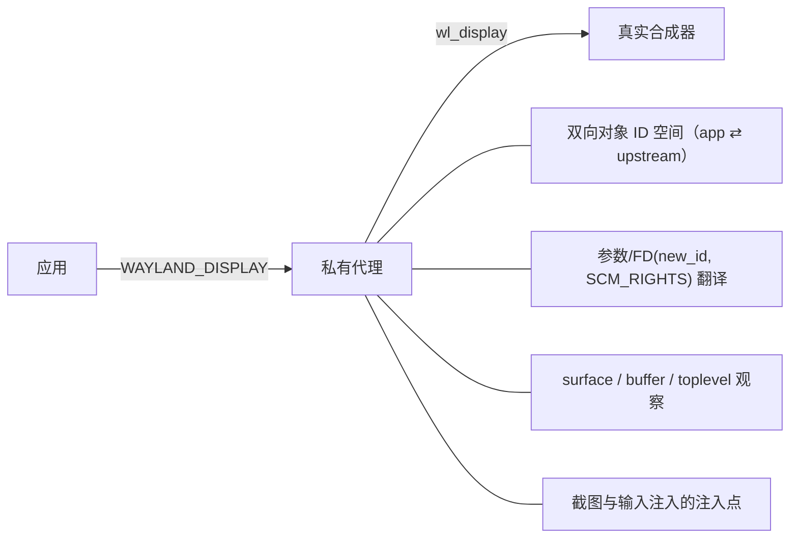
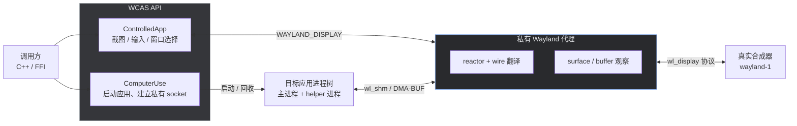

# WCAS

**W**indow **C**ontrol **A**gent **S**ystem · 窗口控制代理系统

一个**独立的**跨平台窗口捕获 / 输入注入 / 进程劫持库。当前只实现了 **Linux / Wayland** 路径；WinAPI 与 Cocoa 后端尚未开始。

> **状态：早期实验性。** 尚未发布 API，允许破坏性变更。Wayland 核心链路已可用， KMS、XWayland 完整回退、后台截图调度等仍在补全。
>
> **Interface 迁移：2026-10-22 暂时冻结（约 90%）。** Controller、Capture、DMA-BUF、 FrameSink、Window、Transport、Launch 等后端已按 ABIX Interface 组合；剩余项见 [docs/INTERFACE.md](docs/INTERFACE.md)。

---

## 一、项目理念

桌面自动化的核心矛盾是：**你想控制某个应用，但显示协议不允许你从外部控制它。**

- X11 时代，任意客户端都能抓屏、合成事件、枚举窗口——于是自动化很容易，也很不安全。
- Wayland 出于安全考虑，把这些能力从客户端手里收走了：应用只能看到自己的 surface，输入只能由合成器注入，窗口列表只有合成器知道。

WCAS 的做法是**换一个信任边界**：不去对抗 Wayland 的安全模型，而是**自己启动目标应用**，在应用与真实合成器之间插入一个**私有 Wayland 代理**。对应用来说，它就是合成器；对真实合成器来说，它是唯一的客户端。于是 WCAS 能在**协议层**看见并改写这条连接上的一切，而无需 root、无需合成器私有接口、无需 X11。

由此得到三条设计原则：

1. **只控制自己启动的进程树。** WCAS 不接管桌面上已有的窗口，也不做全桌面捕获。这让它可以安全地跑在用户的日常会话里，而不会变成一个“屏幕监控器”。
2. **协议感知，而非像素代理。** 代理按 wire opcode/签名翻译消息，理解 surface、 buffer、toplevel 的语义，而不是盲转字节。窗口枚举、缩放换算、截图目标选择都建立在这份语义之上。
3. **真实合成器为准。** 所有“是否可用”的判定都以真实 compositor 的行为为准； fake compositor 测试能覆盖协议，但覆盖不了 ID 连续性、缩放、异步 DMA-BUF 等真机细节。

### 理论模型



代理为每条应用连接建立一条独立的 upstream 连接。`new_id` 在 upstream 侧使用**恒等映射**，因为真实 Wayland server 用 `wl_map_insert_at` 校验客户端 `new_id` 必须落在其分配器水位之下（即 ID 必须连续）——高位基址或独立计数器都会漂移而被拒绝。这一点只有真实合成器才会暴露。

## 二、这是什么 / 与其他方案的区别

WCAS 启动一个目标应用，并在它与合成器之间插入私有 Wayland 代理，从而可以：

- **捕获窗口画面** —— `wl_shm` 或 DMA-BUF（Vulkan 导入优先，线性 mmap 回退）
- **注入输入** —— 鼠标移动/点击/长按滑动/滚轮、按键与组合键、Unicode 文本
- **枚举与切换窗口** —— 一个应用的多进程、多 surface 窗口均可列出并指定目标
- **跟踪几何与光标** —— frame 像素与 surface 逻辑像素之间的正确换算

| 方案                                | 截图范围                       | 需要 X11                | 需要改动被控应用           |
| ----------------------------------- | ------------------------------ | ----------------------- | -------------------------- |
| grim / spectacle / gnome-screenshot | 整屏或单窗口（依赖合成器工具） | 否                      | 否                         |
| X11 + XComposite                    | 单窗口                         | **是**                  | 否                         |
| **WCAS**                            | **被启动应用的窗口**           | 否（XWayland 仅作回退） | 否，但**必须由 WCAS 启动** |

典型场景：让自动化 agent 启动一个游戏或 GUI，看清它的画面，再把操作打回它的窗口里。

### 适配的游戏

| 状态     | 游戏                       |
| -------- | -------------------------- |
| 已适配   | 明日方舟、明日方舟：终末地 |
| 计划适配 | 鸣潮、异环、绝区零         |

## 三、快速开始

### 依赖

- 构建：CMake ≥ 3.20、Ninja、Python 3（构建期生成 wire 元数据）
- 库：OpenCV（core/imgcodecs/imgproc）、Boost（filesystem/system/program_options）、fmt、toml++
- 协议：libwayland（client + server）、xkbcommon、xcb + xcb-composite
- XWayland 输入（可选）：X11 + Xtst（XTest）；缺失时 X11 输入 provider 保留但返回 `feature_not_implemented`
- Interface：ABIX（`main` 最新稳定分支，提供 `SKL/ABIX` 契约与 MICS；默认 runtime-only 构建）
- 错误与条件域：EPCD（依赖 ABIX；通过 `find_package` 复用同一 ABIX target）；WCAS 的 `result<T>` 错误类型为 `skl::epcd::ErrorCode`
- CLI 行编辑：cmdly
- DRM/KMS 辅助：libdrmtap（MIT）
- GPU：Vulkan、libdrm ≥ 2.4.95、liburing
- GPU（可选）：EGL + GLESv2 + GBM —— DMA-BUF 的 EGL 后端。缺失时该后端编译为 stub，采集退回 Vulkan
- 生成元数据所需：`wayland.xml`、`wayland-protocols/`、`wayland-server-protocol.h`

EPCD、ABIX、cmdly、libdrmtap 均先通过 `find_package` 查找已安装的包；找不到时由 CMake 用 `FetchContent` 通过 SSH 自动克隆到依赖目录，默认是源码树下的 `dependencies/`，可用 `-DWCAS_DEPENDENCIES_DIR=<path>` 覆盖。依赖按仓库名放入独立子目录（`ABIX/`、`EPCD/`、`cmdly/`、`libdrmtap/`），FetchContent 的构建树位于构建目录的 `_deps/`。默认目录中除 [`dependencies/README.md`](dependencies/README.md) 外全部被 git 忽略，不会进入提交；源码树不再包含 `third_party/` 或 git submodule。首次 configure 需要可用 SSH key/agent 与 GitHub 网络；之后可离线复用同一依赖目录。

依赖目录、仓库和版本可通过 cache 变量覆盖，例如：

```sh
cmake -B build/Debug -S . \
  -DWCAS_DEPENDENCIES_DIR=/path/to/wcas-dependencies \
  -DWCAS_EPCD_REPOSITORY=git@github.com:Sukanle/EPCD.git \
  -DWCAS_ABIX_REPOSITORY=git@github.com:Sukanle/ABIX.git \
  -DWCAS_CMDLY_REPOSITORY=git@github.com:Sukanle/cmdly.git \
  -DWCAS_LIBDRMTAP_REPOSITORY=git@github.com:fxd0h/libdrmtap.git
```

> `Sukanle/libdrmtap` 尚未创建；默认使用上游 `fxd0h/libdrmtap`。若 fork 已创建，把 `WCAS_LIBDRMTAP_REPOSITORY` 指向新地址即可。对应版本用 `WCAS_*_TAG` 覆盖。

### 构建

```sh
cmake -B build/Release -S . -DCMAKE_BUILD_TYPE=Release
cmake --build build/Release --parallel
```

开发/调试时可用 `Debug`：

```sh
cmake -B build/Debug -S . -DCMAKE_BUILD_TYPE=Debug
cmake --build build/Debug --parallel
ctest --test-dir build/Debug --output-on-failure
```

> 始终使用**独立构建目录**。历史上曾因混用旧的构建产物误判“协议元数据损坏”。
>
> 默认以 runtime-only 方式构建自动获取的 ABIX，无需预装 LLVM/AMC 或 ABIX 包；若系统已有 ABIX ≥ 0.2.3 / EPCD ≥ 0.1 的 CMake 包，配置 `CMAKE_PREFIX_PATH` 后会自动优先使用已安装版本。

### 启动

```sh
# 直接启动游戏（DXVK / Vulkan 转译）
./proton-inject.sh /path/to/game.exe --graphics-api dxvk --cli

# QtWebEngine 启动器：启动器用 native Wayland + WineD3D
./proton-inject.sh /path/to/Launcher.exe --transport wayland --graphics-api opengl
```

如果希望让启动器自动拉起游戏，需要在启动器设置中关闭“强制 DX11”；否则启动器会给游戏附加 `-force-d3d11`，游戏只会走 D3D11，而不是原生 Vulkan。

自定义启动方式（图形后端、per-exe override、CLI、IPC 等）见 [docs/ADVANCED.md](docs/ADVANCED.md)，包括：

- 启动器/游戏的图形后端选择
- `-force-d3d11`、DXVK、WineD3D 与原生 Vulkan 的区别
- TOML profiles 的完整字段
- CLI 参数、DMA-BUF 采集后端
- IPC / MAA 接管
- 已知问题、安全模型和项目结构

## 四、技术路线

WCAS 分阶段推进，每一阶段都要有对应测试通过后才算完成：

| 阶段 | 内容                                                                                                         | 状态                                |
| ---- | ------------------------------------------------------------------------------------------------------------ | ----------------------------------- |
| 1    | 协议感知代理：registry 过滤、对象映射、参数/FD 翻译、surface/commit 观察                                     | 完成                                |
| 2    | `wl_shm` 捕获：pool/buffer 生命周期、mmap 解码、目标选择、retained frame                                     | 完成                                |
| 2b   | wire 元数据重建：由协议 XML 生成完整 opcode/签名/`new_id` 目标表                                             | 完成                                |
| 3    | 输入：keymap、xkbcommon 布局、修饰键、Unicode、text-input-v3、指针/滚轮/拖拽                                 | 完成                                |
| 4    | DMA-BUF 与 GPU 捕获：Vulkan / EGL+GBM 导入、按能力选后端、线性回退、合成器回退、reactor + 三槽调度、窗口几何 | 大部分完成                          |
| 4b   | KMS：直接 DRM/KMS ioctl（去掉外部 helper 依赖）                                                              | **暂缓**                            |
| 5    | XWayland：独立 Xwayland bridge、native 失败回退、XComposite 捕获、XTest 输入                                 | 基本完成（X11 target capture 待补） |
| 6    | CLI 与脚本：全部参数、窗口管理、长按/滑动、显示器、诊断                                                      | 进行中                              |
| 7    | Interface 化：Controller/Capture/DMA-BUF/Frame/Window/Transport/Launch 契约与 provider                       | 冻结（约 90%）                      |

完整的阶段状态、测试矩阵与历史关键修复见 [docs/STATUS.md](docs/STATUS.md)；与 Rust 参考实现的决策对照见 [docs/REFERENCE.md](docs/REFERENCE.md)。

关键技术决策：

- **wire 元数据在构建期生成。** libwayland 的 `wl_interface` 是客户端接口表（`release`/ `destroy` 与相邻 opcode 合并），**不能**用于 wire 翻译；系统 `wayland.xml` 也不完整（`wl_registry.bind` 缺 `interface`/`version` 参数）。因此由 `codegen/` 在构建期从 `wayland.xml` + `wayland-server-protocol.h` + `wayland-protocols/` 生成权威表。
- **异步 DMA-BUF。** Wine/winewayland 走 `zwp_linux_buffer_params_v1.create`（不携带 `new_id`），`wl_buffer` 在稍后的 `created` 事件才下发；代理必须在 `create` 暂存参数、在 `created` 注册 buffer，否则 `capturable_surface` 永远为假。
- **坐标空间。** 捕获到的是 frame（buffer）像素，而 `wl_pointer` 是 surface-local 逻辑像素；代理跟踪 `wp_viewport.set_destination`、`wl_surface.set_buffer_scale`、`wp_fractional_scale_v1` 得到比例，输入时换算、查询光标时反算。
- **实时性。** 以 `wl_surface.frame` → `wl_callback.done`（“新帧已上屏”）作为屏障，而不是仅看 commit 计数；`ss` 默认等待新帧，`ss now` 立即截图。
- **Interface 组合。** 后端按能力拆成 ABIX Interface：Controller、CaptureSource、 DmaBufDecoder、FrameSink、WindowEnumerator/Resolver、ProcessHost、Focus/Health/Target、 LaunchStrategy；`ControlledApp` 只做 facade，transport 差异由 provider 吸收。详见 [docs/INTERFACE.md](docs/INTERFACE.md)。

## 五、当前能力

### ABIX Interface 架构

WCAS 的输入、截图、DMA-BUF 解码、窗口、推帧、进程/会话和启动策略都通过 ABIX Interface 组合，而不是靠继承或虚函数：

- 契约按**能力**拆分：`PointerController`、`CaptureSource`、`DmaBufDecoder`、`FrameSink`、`WindowEnumerator`、`FocusBackend`、`HealthMonitor`、`TargetSelector` 等；
- provider 是普通 C++ struct，方法表在绑定阶段解析；
- 能力缺失返回 `feature_not_implemented`，不静默回退；
- `ControlledApp` 是 facade，内部由 `SessionContext` + 各 runtime 组合。

完整的契约地图、设计规则、迁移状态和“如何新增 provider”见 [docs/INTERFACE.md](docs/INTERFACE.md)。

### 已实现（Linux / Wayland + XWayland）

- **协议感知代理** —— 翻译 core Wayland 与 47 个扩展协议接口，处理 `new_id`、`SCM_RIGHTS` FD 转发、双向对象 ID 映射、registry allowlist/denylist
- **截图** —— `wl_shm`（mmap ARGB/XRGB）；DMA-BUF 通过 `DmaBufDecoder` 契约按能力选 Vulkan / EGL+GBM / 线性 mmap，无法解码时窗口对齐回退到合成器截图（见 [docs/CAPTURE.md](docs/CAPTURE.md)）；后台采集在独立线程运行，不阻塞 Wayland 消息转发
- **推帧消费** —— `FrameSink` / `FrameBus`：push 式帧 fan-out、per-sink worker/ shared dispatcher、LatestOnly/有界队列/背压与帧池（见 [docs/FRAMES.md](docs/FRAMES.md)）
- **输入注入** —— native：keymap（xkbcommon）解析按键/修饰键、Unicode 文本（优先 text-input-v3）、pointer / scroll / drag、长按、长按滑动、二维拖动；XWayland：Xlib + XTest 的 `X11InputDevice` 实现同一 `PointerController` / `KeyboardController` 契约；指针锁定游戏经 `zwp_relative_pointer_v1` 注入相对位移
- **窗口管理** —— `WindowEnumerator` / `WindowResolver` 枚举进程树内全部窗口（含同一进程的多条 Wayland 连接）、按 index 或平台中性 `TargetId` 切换目标、标注窗口来源（toplevel / subsurface / bare）
- **坐标换算** —— frame 像素与 surface 逻辑像素互换，支持多屏不同缩放
- **XWayland 回退** —— native 超时后启动独立 Xwayland bridge，经 XComposite 捕获，并通过 XTest provider 注入输入
- **进程管理** —— `ProcessHost` 负责独立 process group、`PR_SET_PDEATHSIG`、`SIGINT`→`SIGTERM`→`SIGKILL` 顺序清理，退出时 join 代理线程
- **启动策略** —— `LaunchStrategy` 描述/排序 native → XWayland，`ProcessHost` 执行

### 尚未完成

| 能力                  | 说明                                                                                    |
| --------------------- | --------------------------------------------------------------------------------------- |
| WinAPI 后端           | 计划中，未开始                                                                          |
| Cocoa 后端            | 计划中，未开始                                                                          |
| 多平面 / YUV DMA-BUF  | `DmaBufDecoder` 目前只支持单平面 RGB                                                    |
| KMS 抓取              | 已作为合成器回退接入（需 libdrmtap 与 `CAP_SYS_ADMIN`）；改为直接 DRM/KMS ioctl 暂缓    |
| X11 TargetId capture  | XWayland 输入已接入；按 `TargetId` 选择 X11 窗口捕获尚未完成                            |
| X11 焦点/激活         | XWayland 当前 `FocusBackend::available() == false`                                      |
| Interface 工厂/跨平台 | `TransportBackend::create(LaunchSpec)`、module lease、Windows/macOS provider 为未来计划 |
| 负向协议测试          | 未知 opcode / 版本越界 / 畸形签名                                                       |

## 六、架构



公共 API 之下是一层**能力组合**：`CaptureRuntime`、`WindowRuntime`、Controller、Focus、 Health、Target、FrameBus 各自绑定 ABIX provider；`SessionContext` 提供 transport/session 状态，`ProcessHost` 负责进程生命周期。各 transport 只需提供自己的 provider，不需要让 `ControlledApp` 增加分支。详见 [docs/INTERFACE.md](docs/INTERFACE.md)。

## 七、文档

| 文档                                        | 内容                                                                                             |
| ------------------------------------------- | ------------------------------------------------------------------------------------------------ |
| [ADVANCED.md](docs/ADVANCED.md)             | 高级启动：图形后端、原生 Vulkan/DXVK/WineD3D、per-exe override、TOML profiles、CLI、DMA-BUF、IPC |
| [INTERFACE.md](docs/INTERFACE.md)           | Interface 架构、契约地图、能力边界与 provider 接入规则                                           |
| [STATUS.md](docs/STATUS.md)                 | 阶段状态、测试矩阵与关键修复记录                                                                 |
| [REFERENCE.md](docs/REFERENCE.md)           | Rust 参考实现的决策对照                                                                          |
| [CAPTURE.md](docs/CAPTURE.md)               | DMA-BUF 采集：后端选择、能力协商与回退                                                           |
| [COMPATIBILITY.md](docs/COMPATIBILITY.md)   | compositor / toolkit 兼容矩阵                                                                    |
| [FRAMES.md](docs/FRAMES.md)                 | FrameSink / FrameBus：推帧、线程模型与背压                                                       |
| [CONTROLLER.md](docs/CONTROLLER.md)         | Controller 接口与输入后端                                                                        |
| [MAA-COMPARISON.md](docs/MAA-COMPARISON.md) | 与 MAA Linux 控制器方案的差异                                                                    |
| [PROTON.md](docs/PROTON.md)                 | Proton/Wine 游戏自动化集成                                                                       |
| [SECURITY.md](docs/SECURITY.md)             | 安全边界与报告方式                                                                               |

## 八、许可

本项目采用 [Apache License 2.0](LICENSE) 开源，Copyright 2026 Sukanle。第三方组件归属见 [NOTICE](NOTICE)。libdrmtap（MIT）由 CMake 在构建期获取，以 `SHARED` 方式链接，不并入本仓库源码；依赖源码位于 `dependencies/`。
