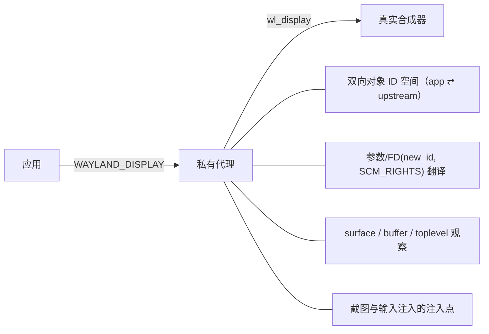
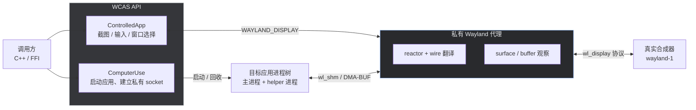

# WCAS

**W**indow **C**ontrol **A**gent **S**ystem · 窗口控制代理系统

一个**独立的**跨平台窗口捕获 / 输入注入 / 进程劫持库。
当前只实现了 **Linux / Wayland** 路径；WinAPI 与 Cocoa 后端尚未开始。

> **状态：早期实验性。** 尚未发布 API，允许破坏性变更。Wayland 核心链路已可用，
> KMS、XWayland 完整回退、后台截图调度等仍在补全。
>
> **Interface 迁移：2026-10-22 暂时冻结（约 90%）。** Controller、Capture、DMA-BUF、
> FrameSink、Window、Transport、Launch 等后端已按 ABIX Interface 组合；剩余项见
> [docs/INTERFACE.md](docs/INTERFACE.md)。

---

## 一、项目理念

桌面自动化的核心矛盾是：**你想控制某个应用，但显示协议不允许你从外部控制它。**

- X11 时代，任意客户端都能抓屏、合成事件、枚举窗口——于是自动化很容易，也很不安全。
- Wayland 出于安全考虑，把这些能力从客户端手里收走了：应用只能看到自己的 surface，
  输入只能由合成器注入，窗口列表只有合成器知道。

WCAS 的做法是**换一个信任边界**：不去对抗 Wayland 的安全模型，而是**自己启动目标应用**，
在应用与真实合成器之间插入一个**私有 Wayland 代理**。对应用来说，它就是合成器；
对真实合成器来说，它是唯一的客户端。于是 WCAS 能在**协议层**看见并改写这条连接上的
一切，而无需 root、无需合成器私有接口、无需 X11。

由此得到三条设计原则：

1. **只控制自己启动的进程树。** WCAS 不接管桌面上已有的窗口，也不做全桌面捕获。
   这让它可以安全地跑在用户的日常会话里，而不会变成一个“屏幕监控器”。
2. **协议感知，而非像素代理。** 代理按 wire opcode/签名翻译消息，理解 surface、
   buffer、toplevel 的语义，而不是盲转字节。窗口枚举、缩放换算、截图目标选择都建立在
   这份语义之上。
3. **真实合成器为准。** 所有“是否可用”的判定都以真实 compositor 的行为为准；
   fake compositor 测试能覆盖协议，但覆盖不了 ID 连续性、缩放、异步 DMA-BUF 等真机细节。

### 理论模型



代理为每条应用连接建立一条独立的 upstream 连接。`new_id` 在 upstream 侧使用**恒等映射**，
因为真实 Wayland server 用 `wl_map_insert_at` 校验客户端 `new_id` 必须落在其分配器水位之下
（即 ID 必须连续）——高位基址或独立计数器都会漂移而被拒绝。这一点只有真实合成器才会暴露。

## 二、这是什么 / 与其他方案的区别

WCAS 启动一个目标应用，并在它与合成器之间插入私有 Wayland 代理，从而可以：

- **捕获窗口画面** —— `wl_shm` 或 DMA-BUF（Vulkan 导入优先，线性 mmap 回退）
- **注入输入** —— 鼠标移动/点击/长按滑动/滚轮、按键与组合键、Unicode 文本
- **枚举与切换窗口** —— 一个应用的多进程、多 surface 窗口均可列出并指定目标
- **跟踪几何与光标** —— frame 像素与 surface 逻辑像素之间的正确换算

| 方案                                | 截图范围                       | 需要 X11                | 需要改动被控应用           |
| ----------------------------------- | ------------------------------ | ----------------------- | -------------------------- |
| grim / spectacle / gnome-screenshot | 整屏或单窗口（依赖合成器工具） | 否                      | 否                         |
| X11 + XComposite                    | 单窗口                         | **是**                  | 否                         |
| **WCAS**                            | **被启动应用的窗口**           | 否（XWayland 仅作回退） | 否，但**必须由 WCAS 启动** |

典型场景：让自动化 agent 启动一个游戏或 GUI，看清它的画面，再把操作打回它的窗口里。

### 适配的游戏

| 状态     | 游戏                       |
| -------- | -------------------------- |
| 已适配   | 明日方舟、明日方舟：终末地 |
| 计划适配 | 鸣潮、异环、绝区零         |

## 三、技术路线

WCAS 分阶段推进，每一阶段都要有对应测试通过后才算完成：

| 阶段 | 内容                                                                                                         | 状态                                |
| ---- | ------------------------------------------------------------------------------------------------------------ | ----------------------------------- |
| 1    | 协议感知代理：registry 过滤、对象映射、参数/FD 翻译、surface/commit 观察                                     | 完成                                |
| 2    | `wl_shm` 捕获：pool/buffer 生命周期、mmap 解码、目标选择、retained frame                                     | 完成                                |
| 2b   | wire 元数据重建：由协议 XML 生成完整 opcode/签名/`new_id` 目标表                                             | 完成                                |
| 3    | 输入：keymap、xkbcommon 布局、修饰键、Unicode、text-input-v3、指针/滚轮/拖拽                                 | 完成                                |
| 4    | DMA-BUF 与 GPU 捕获：Vulkan / EGL+GBM 导入、按能力选后端、线性回退、合成器回退、reactor + 三槽调度、窗口几何 | 大部分完成                          |
| 4b   | KMS：直接 DRM/KMS ioctl（去掉外部 helper 依赖）                                                              | **暂缓**                            |
| 5    | XWayland：独立 Xwayland bridge、native 失败回退、XComposite 捕获、XTest 输入                                 | 基本完成（X11 target capture 待补） |
| 6    | CLI 与脚本：全部参数、窗口管理、长按/滑动、显示器、诊断                                                      | 进行中                              |
| 7    | Interface 化：Controller/Capture/DMA-BUF/Frame/Window/Transport/Launch 契约与 provider                       | 冻结（约 90%）                      |

完整的阶段状态、测试矩阵与历史关键修复见 [docs/STATUS.md](docs/STATUS.md)；与 Rust 参考实现的
决策对照见 [docs/REFERENCE.md](docs/REFERENCE.md)。

关键技术决策：

- **wire 元数据在构建期生成。** libwayland 的 `wl_interface` 是客户端接口表（`release`/
  `destroy` 与相邻 opcode 合并），**不能**用于 wire 翻译；系统 `wayland.xml` 也不完整
  （`wl_registry.bind` 缺 `interface`/`version` 参数）。因此由 `codegen/` 在构建期从
  `wayland.xml` + `wayland-server-protocol.h` + `wayland-protocols/` 生成权威表。
- **异步 DMA-BUF。** Wine/winewayland 走 `zwp_linux_buffer_params_v1.create`（不携带
  `new_id`），`wl_buffer` 在稍后的 `created` 事件才下发；代理必须在 `create` 暂存参数、
  在 `created` 注册 buffer，否则 `capturable_surface` 永远为假。
- **坐标空间。** 捕获到的是 frame（buffer）像素，而 `wl_pointer` 是 surface-local 逻辑像素；
  代理跟踪 `wp_viewport.set_destination`、`wl_surface.set_buffer_scale`、
  `wp_fractional_scale_v1` 得到比例，输入时换算、查询光标时反算。
- **实时性。** 以 `wl_surface.frame` → `wl_callback.done`（“新帧已上屏”）作为屏障，
  而不是仅看 commit 计数；`ss` 默认等待新帧，`ss now` 立即截图。
- **Interface 组合。** 后端按能力拆成 ABIX Interface：Controller、CaptureSource、
  DmaBufDecoder、FrameSink、WindowEnumerator/Resolver、ProcessHost、Focus/Health/Target、
  LaunchStrategy；`ControlledApp` 只做 facade，transport 差异由 provider 吸收。详见
  [docs/INTERFACE.md](docs/INTERFACE.md)。

## 四、当前能力

### ABIX Interface 架构

WCAS 的输入、截图、DMA-BUF 解码、窗口、推帧、进程/会话和启动策略都通过 ABIX Interface
组合，而不是靠继承或虚函数：

- 契约按**能力**拆分：`PointerController`、`CaptureSource`、`DmaBufDecoder`、
  `FrameSink`、`WindowEnumerator`、`FocusBackend`、`HealthMonitor`、`TargetSelector` 等；
- provider 是普通 C++ struct，方法表在绑定阶段解析；
- 能力缺失返回 `feature_not_implemented`，不静默回退；
- `ControlledApp` 是 facade，内部由 `SessionContext` + 各 runtime 组合。

完整的契约地图、设计规则、迁移状态和“如何新增 provider”见
[docs/INTERFACE.md](docs/INTERFACE.md)。

### 已实现（Linux / Wayland + XWayland）

- **协议感知代理** —— 翻译 core Wayland 与 47 个扩展协议接口，处理 `new_id`、
  `SCM_RIGHTS` FD 转发、双向对象 ID 映射、registry allowlist/denylist
- **截图** —— `wl_shm`（mmap ARGB/XRGB）；DMA-BUF 通过 `DmaBufDecoder` 契约按能力选
  Vulkan / EGL+GBM / 线性 mmap，无法解码时窗口对齐回退到合成器截图（见
  [docs/CAPTURE.md](docs/CAPTURE.md)）；后台采集在独立线程运行，不阻塞 Wayland 消息转发
- **推帧消费** —— `FrameSink` / `FrameBus`：push 式帧 fan-out、per-sink worker/
  shared dispatcher、LatestOnly/有界队列/背压与帧池（见 [docs/FRAMES.md](docs/FRAMES.md)）
- **输入注入** —— native：keymap（xkbcommon）解析按键/修饰键、Unicode 文本（优先
  text-input-v3）、pointer / scroll / drag、长按、长按滑动、二维拖动；XWayland：Xlib +
  XTest 的 `X11InputDevice` 实现同一 `PointerController` / `KeyboardController` 契约；
  指针锁定游戏经 `zwp_relative_pointer_v1` 注入相对位移
- **窗口管理** —— `WindowEnumerator` / `WindowResolver` 枚举进程树内全部窗口（含同一进程的
  多条 Wayland 连接）、按 index 或平台中性 `TargetId` 切换目标、标注窗口来源
  （toplevel / subsurface / bare）
- **坐标换算** —— frame 像素与 surface 逻辑像素互换，支持多屏不同缩放
- **XWayland 回退** —— native 超时后启动独立 Xwayland bridge，经 XComposite 捕获，
  并通过 XTest provider 注入输入
- **进程管理** —— `ProcessHost` 负责独立 process group、`PR_SET_PDEATHSIG`、
  `SIGINT`→`SIGTERM`→`SIGKILL` 顺序清理，退出时 join 代理线程
- **启动策略** —— `LaunchStrategy` 描述/排序 native → XWayland，`ProcessHost` 执行

### 尚未完成

| 能力                  | 说明                                                                                    |
| --------------------- | --------------------------------------------------------------------------------------- |
| WinAPI 后端           | 计划中，未开始                                                                          |
| Cocoa 后端            | 计划中，未开始                                                                          |
| 多平面 / YUV DMA-BUF  | `DmaBufDecoder` 目前只支持单平面 RGB                                                    |
| KMS 抓取              | 已作为合成器回退接入（需 libdrmtap 与 `CAP_SYS_ADMIN`）；改为直接 DRM/KMS ioctl 暂缓    |
| X11 TargetId capture  | XWayland 输入已接入；按 `TargetId` 选择 X11 窗口捕获尚未完成                            |
| X11 焦点/激活         | XWayland 当前 `FocusBackend::available() == false`                                      |
| Interface 工厂/跨平台 | `TransportBackend::create(LaunchSpec)`、module lease、Windows/macOS provider 为未来计划 |
| 负向协议测试          | 未知 opcode / 版本越界 / 畸形签名                                                       |

## 五、架构



公共 API 之下是一层**能力组合**：`CaptureRuntime`、`WindowRuntime`、Controller、Focus、
Health、Target、FrameBus 各自绑定 ABIX provider；`SessionContext` 提供 transport/session
状态，`ProcessHost` 负责进程生命周期。各 transport 只需提供自己的 provider，不需要让
`ControlledApp` 增加分支。详见 [docs/INTERFACE.md](docs/INTERFACE.md)。

## 六、开发与依赖

### 依赖

- 构建：CMake ≥ 3.20、Ninja、Python 3（构建期生成 wire 元数据）
- 库：OpenCV（core/imgcodecs/imgproc）、Boost（filesystem/system/program_options）、fmt
- 协议：libwayland（client + server）、xkbcommon、xcb + xcb-composite
- XWayland 输入（可选）：X11 + Xtst（XTest）；缺失时 X11 输入 provider 保留但返回
  `feature_not_implemented`
- Interface：ABIX（v0.2.3，提供 `SKL/ABIX` 契约与 MICS；默认 runtime-only 构建）
- 错误与条件域：EPCD（依赖 ABIX；通过 `find_package` 复用同一 ABIX target）
- CLI 行编辑：cmdly
- DRM/KMS 辅助：libdrmtap（MIT）
- GPU：Vulkan、libdrm ≥ 2.4.95、liburing
- GPU（可选）：EGL + GLESv2 + GBM —— DMA-BUF 的 EGL 后端。缺失时该后端编译为 stub，
  采集退回 Vulkan
- 生成元数据所需：`wayland.xml`、`wayland-protocols/`、`wayland-server-protocol.h`

EPCD、ABIX、cmdly、libdrmtap 均先通过 `find_package` 查找已安装的包；找不到时由 CMake
用 `FetchContent` 通过 SSH 自动克隆到依赖目录，默认是源码树下的 `dependencies/`，可用
`-DWCAS_DEPENDENCIES_DIR=<path>` 覆盖。默认目录中除
[`dependencies/README.md`](dependencies/README.md) 外全部被 git 忽略，不会进入提交；
源码树不再包含 `third_party/` 或 git submodule。首次 configure 需要可用 SSH key/agent
与 GitHub 网络；之后可离线复用同一依赖目录。

依赖目录、仓库和版本可通过 cache 变量覆盖，例如：

```sh
cmake -B build/Debug -S . \
  -DWCAS_DEPENDENCIES_DIR=/path/to/wcas-dependencies \
  -DWCAS_EPCD_REPOSITORY=git@github.com:Sukanle/EPCD.git \
  -DWCAS_ABIX_REPOSITORY=git@github.com:Sukanle/ABIX.git \
  -DWCAS_CMDLY_REPOSITORY=git@github.com:Sukanle/cmdly.git \
  -DWCAS_LIBDRMTAP_REPOSITORY=git@github.com:fxd0h/libdrmtap.git
```

> `Sukanle/libdrmtap` 尚未创建；默认使用上游 `fxd0h/libdrmtap`。若 fork 已创建，把
> `WCAS_LIBDRMTAP_REPOSITORY` 指向新地址即可。对应版本用 `WCAS_*_TAG` 覆盖。

### 构建

```sh
cmake -B build/Release -S . -DCMAKE_BUILD_TYPE=Release
cmake --build build/Release --parallel
```

开发/调试时可用 `Debug`：

```sh
cmake -B build/Debug -S . -DCMAKE_BUILD_TYPE=Debug
cmake --build build/Debug --parallel
ctest --test-dir build/Debug --output-on-failure
```

> 始终使用**独立构建目录**。历史上曾因混用旧的构建产物误判“协议元数据损坏”。
>
> 默认以 runtime-only 方式构建自动获取的 ABIX，无需预装 LLVM/AMC 或 ABIX 包；若系统已有
> ABIX 0.2.3 / EPCD 0.1 的 CMake 包，配置 `CMAKE_PREFIX_PATH` 后会自动优先使用已安装版本。

## 七、如何使用

### 7.1 通过 Proton 包装脚本（推荐）

`proton-inject.sh` 会自动设置 `WINEPREFIX`、`WAYLAND_DISPLAY` 指向私有代理，
并按目标程序推断匹配规则。常用示例：

明日方舟（手游移植，OpenGL / WineD3D）：

```sh
./proton-inject.sh /<Proton游戏容器根路径>/drive_c/Program\ Files/Hypergryph\ Launcher/games/Arknights/Arknights.exe --graphics-api opengl --cli
```

明日方舟：终末地（原生 PC 端，DXVK / Vulkan）：

```sh
./proton-inject.sh /<Proton游戏容器根路径>/hypergryph/drive_c/Program\ Files/Hypergryph\ Launcher/games/Arknights\ Endfield/Endfield.exe --bridge-width 3840 --bridge-height 2160 --graphics-api dxvk --cli
```

Lutris 用 `proton-inject-lutris.sh`。

### 7.2 直接用 CLI

```sh
build/Release/proton-inject \
  --program /path/to/app --umu \
  --env WINEPREFIX=/path/to/prefix \
  --capture-backend dmabuf --graphics-api opengl \
  --native-timeout 25 --cli
```

主要启动参数：

| 参数                            | 说明                                                                 |
| ------------------------------- | -------------------------------------------------------------------- |
| `--program, -p`                 | 要启动的可执行文件                                                   |
| `--arg, -s` / `--env, -e`       | 传给程序的参数 / 环境变量（可重复）                                  |
| `--proton` / `--wine` / `--umu` | 启动方式                                                             |
| `--graphics-api, -g`            | `dxvk`(默认) 或 `vulkan`(`vk`，游戏原生) 或 `opengl`(`gl`/`wined3d`) |
| `--capture-backend, -b`         | `client`(默认) / `shm` / `dmabuf` / `kms`                            |
| `--bridge-width/-height, -x/-y` | XWayland 回退桥接分辨率                                              |
| `--match-regex, -r`             | 额外的子窗口进程匹配正则（默认取目标程序父目录）                     |
| `--output`                      | 启动后把窗口移到指定 Hyprland 显示器（如 `DP-2`）                    |
| `--key-delay`                   | 发送 key 前等待秒数（便于手动聚焦）                                  |
| `--allow-activation`            | 放行选中窗口的激活请求，使其接收键盘（会夺取焦点）                   |
| `--debug-all`                   | 打开全部调试类别（等价 `WCAS_DEBUG=1`）                              |
| `--debug-capture`               | 采集/截图调试（调度器丢弃、槽超时）                                  |
| `--debug-dmabuf`                | DMA-BUF 导入/回读诊断（`[wcas:dmabuf]`）                             |
| `--debug-harness`               | 启动/native 等待/XWayland 回退（`[wcas:harness]`）                   |
| `--debug-proxy`                 | 连接生命周期与消息转发（`[wcas:proxy]`）                             |
| `--debug-input`                 | 注入的指针/键盘输入（`[wcas:input]`）                                |
| `--debug-xwayland`              | XWayland 桥（`[wcas:xwayland]`）                                     |
| `--debug-wire`                  | 逐条 Wayland 消息追踪（`[wcas:wire]`）                               |

调试类别可用各自的环境变量单独开启：`WCAS_DEBUG_HARNESS` / `WCAS_DEBUG_PROXY` /
`WCAS_DEBUG_INPUT` / `WCAS_DEBUG_CAPTURE` / `WCAS_DEBUG_DMABUF` /
`WCAS_DEBUG_XWAYLAND` / `WCAS_DEBUG_WIRE`；`WCAS_DEBUG=1` 打开全部。追踪行格式为
`[wcas:<类别> t=<单调毫秒>] ...`，时间戳与 `WINEDEBUG` 同源，便于对齐时序。

CLI 模式下的命令：

```
screenshot|ss [now]          截图（默认等待新帧；ss now 立即截图）
list|ls                      列出窗口，* 标记当前目标
sessions                     列出全部代理会话（含 kbd/ptr/keymap 诊断）
surfaces                     列出全部 surface（role/parent/toplevel/frame/seq）
target <index|app_id|title>  切换目标窗口
move <x> <y>                 移动到坐标
click [<x> <y>]              在坐标点击（省略坐标则点当前位置）
click <hold> <Top|Down|Left|Right|Center> [px]
                             长按滑动，如 `click 4s R 300`
drag <dx> <dy>               不按键移动视角/光标（旋转相机，不触发点击），如 `drag 300 -120`
up|down|left|right|center    相对移动 / 居中
key|press <combo> [hold]     组合键，如 `key ctrl+s`、`key Alt-C`、`key Enter 3s`
escape|esc / type <text>     单键与文本输入
cursor|pxy                   打印当前光标位置
monitor <DP-1|DP-2|...>      把选中窗口移到指定 Hyprland 显示器
activation on|off            放行/禁止选中窗口的激活请求
status                       进程、transport、commit/frame 计数、窗口尺寸
help|h / quit|exit|q
```

交互模式下命令行由 [cmdly](https://github.com/Sukanle/cmdly) 提供：支持行内编辑
（←/→/Home/End 及退格）、↑/↓ 历史、Tab 补全命令名，Ctrl-C / Ctrl-D 退出。stdin
不是终端时（脚本管道）自动退回逐行读取，不输出提示符与回显。

常用工作流：

```
list                 # 看有哪些窗口
target 1             # 选中主窗口
ss                   # 截一张图（等待新帧）
click 4s R 300       # 长按 4 秒并向右滑 300px
drag 300 -120        # 向右上移动视角（旋转相机，不触发点击）
key Alt-C            # 发送 Alt+C
```

### 7.3 DMA-BUF 采集后端

游戏窗口通常通过 DMA-BUF 提交 `wl_buffer`，其布局由 DRM modifier 描述（可能是厂商 tiled /
block-linear，甚至带帧缓冲压缩）。WCAS 用环境变量选择解码后端：

| 变量                  | 取值                            | 说明                                                               |
| --------------------- | ------------------------------- | ------------------------------------------------------------------ |
| `WCAS_DMABUF_BACKEND` | `auto`(默认) / `vulkan` / `egl` | DMA-BUF 解码后端                                                   |
| `WCAS_CAPTURE_TIMING` | 设 `1` 打开                     | 每次采集打印 `[wcas] capture timing: backend=... <ms>`（默认关闭） |

三个后端：

- **`vulkan`** —— `VK_EXT_image_drm_format_modifier` 显式导入 + `vkCmdCopyImageToBuffer`
  → staging → CPU 解码；只在设备为“该格式 + modifier + `TRANSFER_SRC`”声明支持时可用。
- **`egl`** —— EGL/GBM（`EGL_EXT_image_dma_buf_import[_modifiers]`）导入 → GL 纹理 → FBO
  → `glReadPixels`。合成器同款路径，能解出 NVIDIA 帧缓冲压缩（modifier `c != 0`）的 surface。
- **`auto`** —— 按**能力查询**选择：线性或 Vulkan 声明支持 → Vulkan；否则若 EGL 广播了该
  格式+modifier → EGL；两者都不支持则**明确拒绝**，不会把驱动在不支持的布局上解出的花屏
  当成成功。

原则是“导入成功 ≠ 像素正确”：Vulkan 路径对未被声明支持的 modifier 会标
`modifier_supported=NO | pixels=unverified`，而不是谎称已验证。

当窗口自身的 buffer 两条路径都无法解码时，`auto` 会**窗口对齐**回退到合成器截图：先用
`swaymsg`/`hyprctl`/`xdotool` 求出窗口矩形，再用 `grim -g`（合成器布局坐标，缩放安全）或
KMS 裁剪读取合成结果，不会返回整屏或多显示器拼接。完整判定与能力查询见
[docs/CAPTURE.md](docs/CAPTURE.md)。

### 7.4 IPC 会话（MAA 接管）

`proton-inject.sh` 默认以 `--serve` 启动一个常驻会话，并通过 Unix domain socket 暴露
控制接口；这样用户从快捷方式启动游戏后，MAA 等外部程序可以 attach，而不需要自己重新
启动游戏。

```sh
# 默认：serve 模式（不读 stdin，适合快捷方式）
./proton-inject.sh game.exe

# 交互调试；或显式禁用 serve
./proton-inject.sh game.exe --cli
./proton-inject.sh game.exe --no-serve

# 自定义 socket / 脱离终端
./proton-inject.sh game.exe --socket /run/user/1000/wcas/my.sock --detach
```

客户端：

```sh
wcasctl list                               # 列出活动 socket
wcasctl status                             # pid/frame/windows/transport
wcasctl windows                            # 窗口列表
wcasctl capture --out shot.png             # PNG 截图
wcasctl capture-sdm --out frame.bgr        # 共享内存 raw BGR（无 PNG/base64）
wcasctl frames-subscribe 30                # 后台连续写入 SDM ring（30fps）
wcasctl frames-status                      # 查看持续发布状态/seq
wcasctl frames-unsubscribe                 # 停止持续发布
wcasctl click 640 360                      # frame 坐标
wcasctl move 640 360
wcasctl key ctrl+a
wcasctl type hello
wcasctl stop                               # 结束受控游戏
```

socket 默认位于 `$XDG_RUNTIME_DIR/wcas/<pid>.sock`，`latest` 指向最近会话；连接使用
`SO_PEERCRED` 校验同 UID，目录 0700、socket 0600。协议为长度前缀 JSON。

截图有两种数据面：

- `capture`：PNG + base64，适合低频 OCR；
- `capture-sdm`：返回共享内存 channel，客户端直接读取 raw BGR/BGRA，避免 PNG/base64
  和 UDS 像素传输；帧带 `width/height/stride/format`，由客户端按 stride 解析。
- `frames-subscribe`：后台定时捕获并持续写入同一 ring；`frames-status` 返回
  `running/attempts/writes/errors` 与最新 `seq`，MAA 可自行 `wait_for_frame`。

键盘注入需要目标窗口获得键盘焦点；若窗口不接收键盘，可在启动时加
`--allow-activation`，或先用 `move/click` 激活目标窗口。

## 八、现有问题

### 8.1 明日方舟（手游移植）按键无效

现象：主窗口（`Arknights.exe` / 明日方舟）**鼠标点击正常，但按键无效**（例如 Esc 不触发返回）。

排查结论：**不是 WCAS 注入层的问题。** 用自建 native 探针验证，注入完全正确：

- `key Enter 1s` → 客户端收到 `wl_keyboard.key key=28`（evdev Return）按下…释放
- `key Alt-C 500ms` → `Alt`(56)↓、`c`(46)↓↑、`Alt`↑

同一套注入在其它游戏、以及 Qt/GTK/Electron 等应用上均正常。明日方舟 PC 端是从手游移植，
其键盘处理（很可能走 RawInput / 只认真实前台窗口）比原生 PC 端（如终末地）弱，
对合成注入不响应。**这是游戏自身的行为，非 WCAS 缺陷。**

已知缓解手段（均未能让明日方舟响应合成按键，但值得记录）：

- `--allow-activation`：放行选中窗口的 `xdg_activation_v1.activate`，使其被合成器激活；
- `--key-delay N`：发送前等待，手动聚焦窗口；
- `activation on` + 点击窗口后再按键。

后续可能的方向：改走 X11/XWayland 注入（Wine 对 X11 输入处理更成熟），或在合成器层
真正激活窗口后再注入。

### 8.2 终末地启动偶发退出（Exit 222）

现象：经 WCAS 启动《明日方舟：终末地》时，**偶尔**在加载初期（LOGO 之后）进程整体退出，
退出码 **222**（腾讯 WeTest CrashSight 致命异常）。

排查结论：**根因是腾讯 ACE 反作弊驱动与 Wine/Proton 的 win32 内核接口不兼容，不是 WCAS 的问题。**

- 游戏日志可见 ACE 驱动调用 Wine 未实现的内核函数，Wine 直接 abort：
    ```
    wine: Call from ... to unimplemented function ntoskrnl.exe.InbvAcquireDisplayOwnership, aborting
    wine: Call from ... to unimplemented function ntoskrnl.exe.SeQueryInformationToken, aborting
    ```
- 这些 abort 在**不经 WCAS、直连 `umu-run`** 时同样出现；直连通常存活，经 WCAS（私有 Wayland
  代理）时偶发致命。代理只改变了时序，且逐条消息对比确认**代理没有漏转发或
  改写消息**——根因不在 WCAS。
- 相关上游：DW-Proton issue #64 曾据此提交 `ntoskrnl` stub 补丁，但被维护者判定为启动参数
  误判并关闭（stock Proton 可正常启动）。

缓解：换用已验证的 Proton（GE / Experimental / CachyOS），或关注 Wine/DW-Proton 对上述
`ntoskrnl` 函数的支持。WCAS 侧无法修复 Wine 内部未实现的接口。

### 8.3 其它已知限制

- **多平面 / YUV DMA-BUF** 不支持，遇到会捕获失败。
- **压缩 surface 依赖 EGL 后端**：NVIDIA 帧缓冲压缩（modifier `c != 0`）在 Vulkan 上既不被
  列出也不支持 `TRANSFER_SRC`/`SAMPLED`，只能经 EGL/GBM 解出。若某设备两个后端都不广播该
  布局，WCAS 会明确拒绝而不是输出花屏。
- **KMS 抓取**依赖 libdrmtap 与 `CAP_SYS_ADMIN`；作为合成器回退时其裁剪按物理像素，
  输出缩放非 1:1 时可能出现偏移（此时 `grim -g` 优先，因为用的是布局坐标）。
- **X11 目标捕获/焦点**：XWayland 输入已接入，但按 `TargetId` 选择 X11 窗口捕获、
  `_NET_ACTIVE_WINDOW` 焦点仍待实现。
- 某些应用（如公告层、CEF）会**泄漏大量 surface** 且从不销毁；WCAS 用提交新近度区分活跃窗口，
  但历史 surface 仍会累积。
- **激活与不抢焦点天生冲突**：要让 Unity/Wine 收键通常需要窗口被激活，而激活会带走用户焦点。
  新窗口抢焦点主要是合成器（如 Hyprland 默认聚焦新 toplevel）行为，可用窗口规则缓解：

    ```conf
    misc {
        focus_on_activate = false
        initial_workspace_tracking = 0
    }
    windowrulev2 = noinitialfocus, class:^(arknights\.exe)$
    ```

## 九、安全模型

WCAS 代理显示协议并合成输入，属于**安全敏感基础设施**。涉及认证、协议过滤、进程归属或
清理的改动需要显式评审。核心约束：

- 仅接受**同 UID** 的对端（内核 `SO_PEERCRED`）
- 私有 Wayland socket 权限 `0600`
- 永不向客户端暴露特权（跨客户端）Wayland 接口
- **不实现**环境级全桌面捕获
- 受控子进程设置 `PR_SET_PDEATHSIG` 并被显式回收

WCAS **不**为受控应用提供沙箱：被控应用仍拥有调用方用户的全部文件系统、网络与 D-Bus 权限，
除非调用方另行隔离。WCAS 也**不是**用来隐藏窗口的——被控进程对桌面用户依然可见。

## 十、项目结构

```
include/SKL/               skl 公共头
  Config.h                 skl 全局配置
  ErrorCode.h              skl 错误码基类与兼容宏（WCAS 用 EPCD 静态域替代旧表）
  WCAS/                    WCAS 公共契约（WCAS / Controller / Capture / Frame / Window /
                           Transport / Types / Error / DRM / DMABUF）
  WCAS/Private/            内部头（Debug、Harness、Proxy、DMABUF、X11Capture、XWayland）
src/SKL/WCAS/
  Error.cpp                WCAS EPCD 静态错误域、CategoryRegistry 注册与 std::error_code 适配
  DRM.cpp                  DRM/KMS 与窗口几何
  DMABUF.cpp               DMA-BUF 能力探测
  Private/Proxy/           Wayland 代理：Reactor、wire 翻译、Interfaces、surface 观察、
                           输入、截图槽位/调度、DMA-BUF 解码、Vulkan / EGL+GBM 导入
  Private/Harness/         ComputerUse、ControlledApp、ProcessHost、SessionContext、
                           Capture/Window/Focus/Health/Target/FrameBus/LaunchStrategy、
                           X11 XTest 输入
  Private/XWayland.cpp     XWayland bridge
  Private/X11Capture.cpp   X11/XComposite 抓取与窗口枚举
cmake/
  Dependencies.cmake       find_package / FetchContent 依赖引导（EPCD、ABIX、cmdly、libdrmtap）
  Findlibdrmtap.cmake      已安装 libdrmtap 的查找模块
dependencies/              CMake 自动克隆的依赖与 FetchContent 构建树（除 README.md 外 git 忽略）
codegen/                   由协议 XML 生成 wire 元数据（构建期执行）
scripts/                   维护脚本（Markdown reflow 等）
tests/                     单元测试与协议集成测试（fake Wayland 环境）
docs/                      项目文档（INTERFACE / STATUS / REFERENCE / CAPTURE / COMPATIBILITY /
                           CONTROLLER / FRAMES / MAA-COMPARISON / Proton / SECURITY）
main.cpp                   库使用示例
proton-inject.cpp          CLI
proton-inject*.sh          Proton / Lutris 启动包装
```

## 十一、许可

本项目采用 [Apache License 2.0](LICENSE) 开源，Copyright 2026 Sukanle。
第三方组件归属见 [NOTICE](NOTICE)。libdrmtap（MIT）由 CMake 在构建期获取，
以 `SHARED` 方式链接，不并入本仓库源码；依赖源码位于 `dependencies/`。
