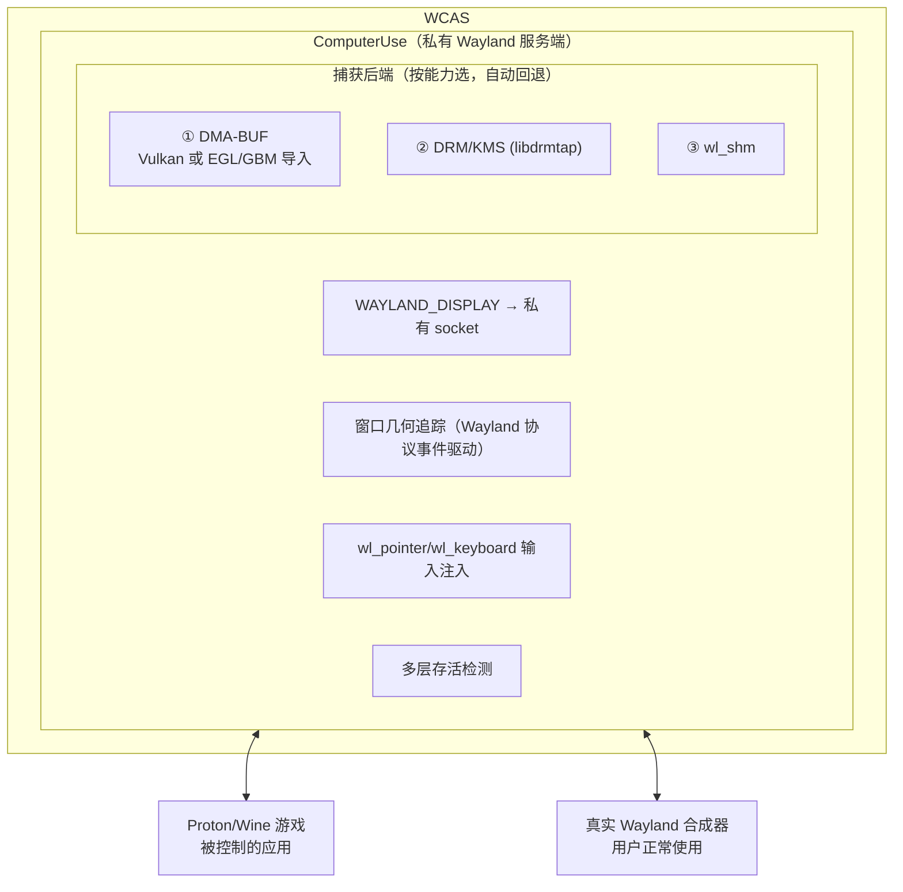

# Proton/Wine 游戏集成指南

## 概述

WCAS 是 Wayland 原生的窗口捕获 / 输入注入工具。它为被启动的应用创建**私有 Wayland 服务端**来接管应用；与 Proton/Wine 结合时，可以捕获 Windows 游戏的画面，并把鼠标 / 键盘输入打回游戏窗口。

本文说明 WCAS **如何与 Proton 游戏结合**：启动方式、私有 seat 的机制、捕获与输入路径，以及常见问题。采集后端的技术细节见 [CAPTURE.md](CAPTURE.md)。

### 适配的游戏

| 状态     | 游戏                       |
| -------- | -------------------------- |
| 已适配   | 明日方舟、明日方舟：终末地 |
| 计划适配 | 鸣潮、异环、绝区零         |

## 工作原理



WCAS 启动游戏进程，并把环境变量 `WAYLAND_DISPLAY` 指向私有 socket。游戏的所有 Wayland 请求都被代理到真实合成器，同时保留一份副本用于捕获与输入注入。对游戏而言 WCAS 就是合成器；对真实合成器而言 WCAS 是唯一客户端。游戏照常显示，也可被用户手动操作。

## 启动 Proton 游戏

`proton-inject.sh` 负责设置 `WINEPREFIX`、把 `WAYLAND_DISPLAY` 指向私有代理，并按目标程序推断匹配规则。

```sh
./proton-inject.sh /<Proton容器>/drive_c/Program\ Files/.../Endfield.exe \
    --bridge-width 3840 --bridge-height 2160 --graphics-api dxvk --cli
```

- `--graphics-api`：`dxvk`（默认，DXVK/VKD3D）| `vulkan`（游戏原生 Vulkan，无需 DXVK 转译）| `opengl`（WineD3D）；
- `--capture-backend`：`dmabuf`（默认）/ `shm` / `kms` / `client`；
- `--cli`：进入交互命令模式；
- Lutris 用 `proton-inject-lutris.sh`。

### 预设环境变量

| 环境变量                                       | 值              | 说明                                    |
| ---------------------------------------------- | --------------- | --------------------------------------- |
| `PROTON_ENABLE_WAYLAND` / `PROTON_USE_WAYLAND` | `1`             | 强制 Proton 使用 Wayland 后端           |
| `WINEDLLOVERRIDES`                             | `dxgi=n,b`      | 禁用内置 dxgi，让 DXVK 接管             |
| `WINE_GST_REGISTRY_DIR`                        | `/tmp/wine-gst` | 避免 GST 注册表冲突                     |
| `WAYLAND_DISPLAY`                              | 私有 socket     | 自动设置，指向私有代理                  |
| `WCAS_DMABUF_BACKEND`                          | `auto`          | DMA-BUF 后端：`auto` / `vulkan` / `egl` |
| `WCAS_CAPTURE_TIMING`                          | 关              | 设 `1` 打印每次采集耗时                 |

## 集成机制

### 私有 seat

应用的 `wl_shm` / `zwp_linux_dmabuf_v1` 缓冲，以及 `wl_pointer` / `wl_keyboard` / `zwp_text_input_v3` 对象，都经过这条私有 seat。因此 WCAS 能**只捕获这一个应用、只往这一个应用的私有连接注入输入**，不移动真实指针、不抢占用户焦点，也不触碰内核输入子系统。

### 捕获后端（按能力选，自动回退）

| 优先级 | 后端                    | 说明                                                                                                                                                           | 需特权          |
| ------ | ----------------------- | -------------------------------------------------------------------------------------------------------------------------------------------------------------- | --------------- |
| ★★★    | **DMA-BUF**             | 两条导入路径：**Vulkan**（`VK_EXT_image_drm_format_modifier`）与 **EGL/GBM**（`EGL_EXT_image_dma_buf_import[_modifiers]`），按设备能力选择；高效，可后台不抢占 | 无              |
| ★★     | **DRM/KMS (libdrmtap)** | 从内核 DRM 子系统读最终合成帧缓冲，按窗口几何裁剪；**需权限且抢占前端显示**                                                                                    | `CAP_SYS_ADMIN` |
| ★      | **wl_shm**              | 读代理的共享内存缓冲，适用于软件渲染；兼容好但性能差                                                                                                           | 无              |

> 若 DMA-BUF 失败，自动回退到 DRM/KMS → wl_shm。窗口自身缓冲无法解码时，**窗口对齐**回退到合成器截图（grim / KMS），不会返回整屏。

### 输入注入

通过私有 seat 注入 `wl_pointer`（移动 / 点击 / 滚动 / 拖拽）、`wl_keyboard`（按键 / 组合键）与 `zwp_text_input_v3`（Unicode 文本）。坐标以窗口左上角为原点的 frame 像素表示，代理按窗口缩放换算。

### 窗口几何

通过拦截 Wayland 协议事件（`xdg_surface.set_window_geometry`、`xdg_toplevel.configure` 等）得到窗口大小；窗口绝对位置仅在**首次创建**或**拖动 / 缩放结束**时经合成器 IPC 查询一次（`swaymsg` / `hyprctl` / `xdotool`），无需轮询。

### 存活检测

多层检测：Wayland 连接状态 + 子进程状态（`/proc/<pid>`）+ 渲染活跃度（`wl_surface.commit` 计数）。即使游戏崩溃但 Wayland 连接未断开，也能判定为停滞并退出，避免主循环悬挂。

## 捕获细节

### DMA-BUF 异步管线

DMA-BUF 采用异步三阶段管线，避免阻塞 Wayland 代理线程：

```mermaid
flowchart LR
    subgraph S1["Stage 1（Wayland 代理线程）"]
        A1["wl_surface.commit"] --> A2["创建 CaptureJob"]
        A2 --> A3["入队"]
        A3 --> A4["立即返回"]
    end

    subgraph S2["Stage 2（Capture Worker）"]
        B1["EXPORT_SYNC_FILE 快照 fence"] --> B2["VkSemaphore 导入"]
        B2 --> B3["DMA-BUF fd"]
        B3 --> B4["VkImage（DRM modifier 导入）"]
        B4 --> B5["GPU copy 到 staging buffer"]
        B5 --> B6["wait fence"]
    end

    subgraph S3["Stage 3（CPU）"]
        C1["读 staging（紧密排列，行 = width × 4）"] --> C2["解码为 RGB"]
    end

    A3 == "CaptureJob 队列 / 异步交接" ==> B1
    B6 == "GPU 完成 / fence 满足" ==> C1
    A4 -. "不阻塞代理线程" .-> S2
```



### 窗口裁剪

截图默认只返回游戏窗口区域，不含桌面背景与其他窗口。窗口大小来自协议事件，绝对位置来自合成器 IPC（见上）。

### 压缩 surface 走 EGL/GBM

NVIDIA 帧缓冲压缩（DRM modifier 的 `c` 字段非零）在 Vulkan 导入上既不被列出、也不支持 `TRANSFER_SRC`/`SAMPLED`，只能经 **EGL/GBM**（合成器同款路径）解出。`auto` 按能力查询选后端，两者都不支持时**明确拒绝**而非输出花屏；细节见 [CAPTURE.md](CAPTURE.md)。

## CLI 操作

以 `--cli` 启动后可用命令：

```
screenshot|ss [now]          截图（默认等待新帧；ss now 立即截图）
list|ls                      列出窗口，* 标记当前目标
target <index|app_id|title>  切换目标窗口
move <x> <y>                 移动到坐标
click [<x> <y>]              在坐标点击
click <hold> <Top|Down|Left|Right|Center> [px]   长按滑动
drag <dx> <dy>               不按键移动视角/光标（旋转相机，不触发点击）
key|press <combo> [hold]     组合键，如 `key ctrl+s`、`key Alt-C`
escape|esc / type <text>     单键与文本输入
cursor|pxy                   打印当前光标位置
status                       进程、transport、commit/frame 计数、窗口尺寸
help|h / quit|exit|q
```

典型流程：

```
list                 # 看有哪些窗口
target 1             # 选中主窗口
ss                   # 截一张图（等待新帧）
click 4s R 300       # 长按 4 秒并向右滑 300px
drag 300 -120        # 向右上移动视角（旋转相机，不触发点击）
key Alt-C            # 发送 Alt+C
```

## 常见问题

### Q: 游戏启动后黑屏 / 无法捕获画面

- **DRM/KMS 权限不足**：KMS 后端需要 `CAP_SYS_ADMIN`；通常不必用 KMS，DMA-BUF 是首选，失败会自动回退。
- **GPU 驱动不暴露 DRM 主节点**：NVIDIA 专有驱动可能没有 `/dev/dri/card0`；系统会自动回退到 wl_shm 或 DMA-BUF。
- **强制软件渲染**：`GPU_ACCELERATED=0`（环境变量）会让游戏走 wl_shm 路径，兼容性最好。
- **改用 XWayland 回退**：缩短 native 超时（`--native-timeout`）可更快回退到 XWayland 桥。

### Q: 截图包含桌面和其他窗口，没有裁剪到游戏窗口

- **窗口几何尚未追踪到**：游戏启动后需等第一个 `configure`；截图过早会捕获全屏。可在首次 `ss` 前稍等。
- **合成器不支持 IPC 查询**：绝对位置经 `swaymsg` / `hyprctl` / `xdotool` 查询；不支持时位置退化为 `(0,0)`。
- **大小与合成器记录不匹配**：`set_window_geometry` 可能早于 `configure`，系统会在每个 `configure` 时更新尺寸。

### Q: 游戏使用 DXVK/VKD3D 但画面无法捕获

- DXVK 默认输出 dmabuf；若捕获失败，系统会按能力自动回退到 EGL/GBM → DRM/KMS → wl_shm。
- 若某游戏直接输出原生 Vulkan（不经 DXVK 转译），用 `--graphics-api vulkan`。
- `WINEDLLOVERRIDES=dxgi=n,b` 已由包装脚本预设，让 DXVK 接管。

### Q: 游戏崩溃后程序不退出（悬挂）

游戏崩溃时 Wine/Proton 可能不立即关闭 Wayland 连接，导致主循环卡住。WCAS 内置多层存活检测（连接 + 进程 + 渲染活跃度），长时间无新帧即判定停滞。超时默认：首帧 30s（native）/ 120s（XWayland）；运行中停滞 60s（普通）/ 120s（Proton/Wine）。

### Q: DMA-BUF 截图出现花屏 / 撕裂

排查顺序：**后端能力 → modifier → stride → format → plane layout → fence sync**。

- **压缩 surface 的“成功即花屏”**：modifier 带压缩（`c != 0`，NVIDIA 常见 `0x0300...` 前缀）时 Vulkan 导入会成功但花屏；`auto` 会改走 EGL/GBM。日志里 Vulkan 路径标 `modifier_supported=NO | pixels=unverified`。
- **modifier 高低位颠倒**：Wayland 以 `modifier_hi`（高 32 位）与 `modifier_lo`（低 32 位）传递，需按 `(hi << 32) | lo` 拼合；NVIDIA modifier 通常以 `0x0300...` 开头。
- **staging buffer 行地址**：GPU copy 到 staging 后是**紧密排列**的，行大小按 `width × 4`，不能用 DMA-BUF stride。
- **fence 顺序**：必须先导出 sync_file 再导入 DMA-BUF image，否则导入会关闭 fd。

### Q: 同时控制多个游戏窗口 / 与 Steam 集成

- 多次启动即多个独立会话：`proton-inject.sh <game1.exe>` 与 `proton-inject.sh <game2.exe>` 各自独立，在各自 CLI 里 `target` 切换。
- Steam 集成：包装脚本透传 `SteamGameId`、`STEAM_COMPAT_CLIENT_INSTALL_PATH`、`STEAM_COMPAT_DATA_PATH` 等环境变量。

## 相关文档

- [CAPTURE.md](CAPTURE.md) —— DMA-BUF 后端选择、能力协商、合成器回退与计时
- [README.md](../README.md) —— 项目总览与 CLI 参数
